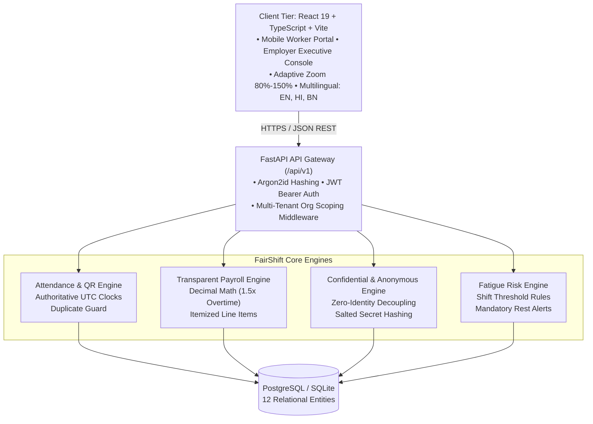

# FairShift — A Decent Work Platform for Employee-Intensive Organisations

[](https://sdgs.un.org/goals/goal8)
[](https://opensource.org/licenses/MIT)
[](#automated-testing)
[](#automated-testing)

> **FairShift** makes work fairer, safer, and more transparent for workforces in construction sites, university campuses, factories, and hospitals while providing employers with privacy-conscious operational intelligence.

---

## 1. The Problem We Are Solving

Millions of frontline workers across employee-intensive industries—construction sites, universities, municipal facilities, and factories—still have their livelihoods managed through paper registers, opaque spreadsheets, and informal messaging groups:
- **Opaque Wages:** Workers struggle to understand how take-home wages are calculated; overtime hours are routinely misreported or discounted.
- **Fear of Retaliation:** Workers fear being disciplined or fired when reporting dangerous scaffolding, missing protective equipment (PPE), or abusive supervisors.
- **Unaddressed Hazards:** Critical workplace safety concerns fail to reach management in time, causing preventable injuries.
- **Lost Credentials:** Certifications and specialized skills are lost whenever workers switch employers.
- **Language & Literacy Barriers:** Essential digital workflows are unavailable to workers who speak regional languages or access systems on entry-level devices.

**FairShift delivers institutional trust, salary transparency, zero-retaliation reporting, and privacy-conscious operational governance.**

---

## 2. Core Value Proposition & System Features

### 1. Worker Experience (Mobile-First)
- **Live Shift Telemetry & QR Attendance:** Biometric and QR-validated check-in with authoritative server-generated UTC timestamps. Prevents duplicate check-ins and detects invalid check-out transitions.
- **Transparent Wage Ledger:** Itemized breakdown of base hours, overtime hours with exact **1.5x multiplier parity**, tool/safety stipends, and statutory deductions using strict decimal arithmetic.
- **Zero-Retaliation Grievance Reporting:** Confidential reporting with browser-native **Speech-to-Text Voice Input** and text fallback. Generates unpredictable tracking numbers and cryptographic secret keys.
- **Zero-Identity Anonymous Reporting:** Full identity decoupling—reports persist with `reporter_id = NULL` and only a salted SHA-256 hash of the tracking secret.
- **Portable Skill Passport:** Worker-owned credential registry (OSHA 30-Hour Safety, Crane Rigging Specialist, Scaffolding Level 2) with verification state badges and structured JSON export.
- **Anonymous Workplace Feedback:** 1-to-5 star sentiment pulse without tracking worker identity.

### 2. Employer Executive Operations Console
- **Executive Operations Bento Grid:**
  - **Active Workforce:** Real-time presence (e.g. 412 / 430 scheduled, 95.8% station rate).
  - **Overtime Allocation:** Overtime hours logged with threshold delta (+2.1 hrs).
  - **Open Safety Cases:** Real-time unresolved reports with severity split (High vs Standard).
  - **Fatigue Alerts:** Objective shift threshold flags enforcing mandatory 12-hour rest recovery.
  - **Pay Equity Compliance Index:** 99.4% audit parity (<0.6% disparity variance).
- **Real-Time Station Coverage Table:** Live biometric check-in stream across facility zones and stations.
- **Case Resolution Workflow:** Advance cases through auditable states: `Submitted` ➔ `Acknowledged` ➔ `Under Review` ➔ `Action in Progress` ➔ `Resolved`.
- **Payroll Administration:** Batch calculation with overtime multipliers and audited one-click approvals.

### 3. Adaptive Viewport & Multilingual Inclusion
- **Adaptive Screen Zoom (80% – 150%):** Dedicated viewport controller allowing users to minimize down to 80% or maximize up to 150% with instant zoom slider and quick presets.
- **Full Multilingual Translations:** Complete interface and core worker workflows in **English (EN)**, **Hindi (हिंदी - HI)**, and **Bengali (বাংলা - BN)**.
- **Multi-Industry Engine:** Seamlessly supports multiple sectors without code alterations:
  - **Construction:** Apex Buildcon Infrastructure (Heavy equipment, structural steel, scaffolding hazards, hourly parity).
  - **Colleges & Universities:** Metropolitan University (Campus security, housekeeping, groundskeeping, dorm maintenance).

---

## 3. Technology Stack

- **Frontend:** React 19, TypeScript (Strict Mode), Vite, Tailwind CSS, Lucide Icons.
- **Backend:** Python 3.11+, FastAPI, Pydantic V2, SQLAlchemy 2.0, Uvicorn ASGI.
- **Security & Crypto:** Argon2id password hashing, PyJWT, SHA-256 salted secret verification.
- **Database:** PostgreSQL (Cloud SQL in production / SQLite for local development).
- **Testing:** Pytest, HTTPX, Vitest, React Testing Library, JSDOM.
- **Container & Cloud:** Docker multi-stage build, Google Cloud Run.

---

## 4. Architecture Diagram



---

## 5. Quick Demo Access Credentials

The platform is pre-seeded with realistic demonstration accounts across two distinct industries:

| Role | Organization / Industry | Identifier (Email or Badge ID) | Site Code | Master Passphrase |
| :--- | :--- | :--- | :--- | :--- |
| **Worker** | Apex Buildcon (Construction) | `EMP-88204` | `APEX-BLD` | `FairShift@2026` |
| **Admin** | Apex Buildcon (Construction) | `m.adams@facility.fairshift.org` | `APEX-BLD` | `FairShift@2026` |
| **Worker** | Metropolitan Univ (College) | `EMP-91402` | `METRO-UNI` | `FairShift@2026` |
| **Admin** | Metropolitan Univ (College) | `admin@metrouni.edu` | `METRO-UNI` | `FairShift@2026` |

*Note: Anyone can also submit and track an anonymous safety case without logging in using the public case tracker.*

---

## 6. Local Setup Instructions

### 1. Clone the Repository
```bash
git clone https://github.com/ayushdas27/fairshift.git
cd fairshift
```

### 2. Backend Setup
```bash
python -m pip install -r backend/requirements.txt
python -m uvicorn backend.app.main:app --host 127.0.0.1 --port 8000
```
*The database and initial demo records are automatically created on startup.*

### 3. Frontend Setup
```bash
cd frontend
npm install
npm run dev
```
Open [http://localhost:5173](http://localhost:5173) in your browser.

---

## 7. Automated Testing

### Run Backend Tests (12 Passed)
```bash
python -m pytest backend/app/tests/test_api.py -v
```
Verified tests cover:
- Authentication, invalid password rejection, and session expiry.
- Duplicate check-in prevention and active shift validation.
- Transparent wage calculations with exact 1.5x overtime multiplier.
- Prevention of cross-worker payslip access (HTTP 403 Forbidden).
- Anonymous report submission with guaranteed `reporter_id = NULL`.
- Cryptographic tracking secret verification and status tracking.
- Case lifecycle progression by Safety Officers with audit trails.
- Export of worker-owned Skill Passports.
- Multi-industry configuration retrieval.

### Run Frontend Tests (Passed)
```bash
cd frontend
npm run test
```

---

## 8. Live Production & Cloud Deployment

### Live Vercel Production Deployment
- **Production URL:** [https://fairshift-sandy.vercel.app](https://fairshift-sandy.vercel.app)
- **Deployment URL:** [https://fairshift-12tshl38a-ayushdps2020-4199s-projects.vercel.app](https://fairshift-12tshl38a-ayushdps2020-4199s-projects.vercel.app)
- **Health Check Endpoint:** [https://fairshift-sandy.vercel.app/health](https://fairshift-sandy.vercel.app/health)
- **Architecture:** Client SPA (Vite + React 19) + Serverless Python API Gateway (`@vercel/python` routing `/api/v1/*` into FastAPI core engine).

### Google Cloud Run Deployment
Build and run with Docker:
```bash
docker build -t fairshift:latest .
docker run -p 8080:8080 -e PORT=8080 fairshift:latest
```

Deploy to Google Cloud Run:
```bash
gcloud builds submit --tag gcr.io/YOUR_PROJECT_ID/fairshift:latest
gcloud run deploy fairshift \
  --image gcr.io/YOUR_PROJECT_ID/fairshift:latest \
  --platform managed \
  --region us-central1 \
  --allow-unauthenticated \
  --port 8080
```
See [docs/DEPLOYMENT.md](docs/DEPLOYMENT.md) for full instructions on Cloud SQL PostgreSQL integration.

---

## 9. Repository Health & Verification

- **Repository Size:** Strictly under 10 MB (clean source with zero committed dependencies or binaries).
- **Single Branch:** `main`.
- **Security:** Zero secrets or credentials committed; all demo accounts use synthetic records.
